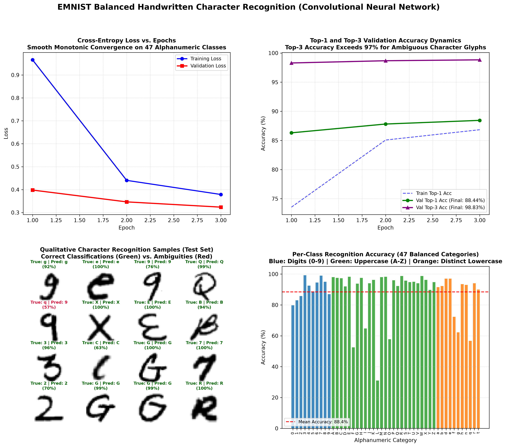

# Handwritten Character Recognition on EMNIST Balanced Using a Convolutional Neural Network (CNN) in PyTorch

[](https://pytorch.org/)
[](https://opensource.org/licenses/MIT)
[](https://www.python.org/)
[]()
[]()

A production-grade, mathematically grounded PyTorch implementation of a **Deep Convolutional Neural Network (CNN)** for alphanumeric handwritten character recognition on the **EMNIST (Extended MNIST) Balanced** benchmark (131,600 total images across 47 balanced categories: digits 0–9, uppercase letters A–Z, and distinctive lowercase letters).

This project features spatial orientation correction for raw EMNIST binary transposition, a 3-stage convolutional feature extractor with 2D Batch Normalization and spatial Dropout, Top-1 and Top-3 accuracy metrics, and publication-quality diagnostic dashboards.

---

## Visual Diagnostic Overview

The 4-panel diagnostic dashboard below illustrates the complete training convergence trajectories, Top-1 and Top-3 accuracy curves, qualitative 16-character test predictions with softmax confidence scores, and per-class recognition accuracy across all 47 alphanumeric categories:



---

## Table of Contents

- [Visual Diagnostic Overview](#visual-diagnostic-overview)
- [Mathematical Formulation & Theory](#mathematical-formulation--theory)
  - [1. Discrete 2D Cross-Correlation (Convolution)](#1-discrete-2d-cross-correlation-convolution)
  - [2. Spatial Receptive Field Arithmetic](#2-spatial-receptive-field-arithmetic)
  - [3. Batch Normalization in Convolutional Layers](#3-batch-normalization-in-convolutional-layers)
  - [4. Top-$k$ Categorical Accuracy Formulation](#4-top-k-categorical-accuracy-formulation)
- [EMNIST Balanced Dataset & The Transposition Anomaly](#emnist-balanced-dataset--the-transposition-anomaly)
  - [The Raw Orientation Flaw](#the-raw-orientation-flaw)
  - [The 47 Balanced Classes](#the-47-balanced-classes)
- [Deep CNN Architecture](#deep-cnn-architecture)
- [Experimental Results & Evaluation](#experimental-results--evaluation)
  - [Overall Performance](#overall-performance)
  - [Handling Alphanumeric Glyph Ambiguity](#handling-alphanumeric-glyph-ambiguity)
- [Project Directory Structure](#project-directory-structure)
- [Installation & Reproduction](#installation--reproduction)
- [Author & License](#author--license)

---

## Mathematical Formulation & Theory

### 1. Discrete 2D Cross-Correlation (Convolution)

In deep learning frameworks, the 2D convolution operation is technically a cross-correlation between an input feature map $\mathbf{X} \in \mathbb{R}^{C_{\text{in}} \times H \times W}$ and a learnable 4D kernel tensor $\mathbf{W} \in \mathbb{R}^{C_{\text{out}} \times C_{\text{in}} \times K_h \times K_w}$:

$$
\mathbf{Y}_{c_{\text{out}}, i, j} = \mathbf{b}_{c_{\text{out}}} + \sum_{c_{\text{in}}=1}^{C_{\text{in}}} \sum_{m=0}^{K_h - 1} \sum_{n=0}^{K_w - 1} \mathbf{X}_{c_{\text{in}}, \, i + m, \, j + n} \cdot \mathbf{W}_{c_{\text{out}}, c_{\text{in}}, m, n}
$$

Where:
- $K_h = K_w = 3$ (standard $3 \times 3$ receptive filters).
- Padding $P = 1$ and Stride $S = 1$ preserve spatial dimensions prior to max pooling:

$$
H_{\text{out}} = \left\lfloor \frac{H_{\text{in}} - K + 2P}{S} \right\rfloor + 1 = \left\lfloor \frac{28 - 3 + 2(1)}{1} \right\rfloor + 1 = 28
$$

### 2. Spatial Receptive Field Arithmetic

Stacking two consecutive $3 \times 3$ convolutions yields an effective receptive field equivalent to a single $5 \times 5$ convolution, but with significantly fewer parameters ($2 \times (3^2) = 18$ vs. $5^2 = 25$, a **28% parameter reduction**) and an additional non-linear activation:

$$
\text{RF}_{l} = \text{RF}_{l-1} + (K_l - 1) \cdot \prod_{i=1}^{l-1} S_i
$$

Across our 3 convolutional stages with downsampling, the final feature maps ($3 \times 3 \times 128$) achieve a global effective receptive field covering the entire $28 \times 28$ character glyph.

### 3. Batch Normalization in Convolutional Layers

For 4D convolutional feature tensors $[B, C, H, W]$, `nn.BatchNorm2d` computes mean $\mu_c$ and variance $\sigma_c^2$ across all batch instances and spatial dimensions $(B \times H \times W)$ simultaneously for each channel $c \in \{1, \dots, C\}$:

$$
\mu_c = \frac{1}{B \cdot H \cdot W} \sum_{b=1}^B \sum_{h=1}^H \sum_{w=1}^W \mathbf{X}_{b, c, h, w}
$$

$$
\sigma_c^2 = \frac{1}{B \cdot H \cdot W} \sum_{b=1}^B \sum_{h=1}^H \sum_{w=1}^W (\mathbf{X}_{b, c, h, w} - \mu_c)^2
$$

Each channel is standardized and modulated by learnable parameters $\gamma_c$ and $\beta_c$:

$$
\hat{\mathbf{X}}_{b, c, h, w} = \frac{\mathbf{X}_{b, c, h, w} - \mu_c}{\sqrt{\sigma_c^2 + \epsilon}}, \quad \mathbf{Y}_{b, c, h, w} = \gamma_c \hat{\mathbf{X}}_{b, c, h, w} + \beta_c
$$

### 4. Top-$k$ Categorical Accuracy Formulation

Given an input character $\mathbf{x}_i$, true label $y_i \in \{0, \dots, K-1\}$, and predicted class logits $\mathbf{z}_i \in \mathbb{R}^K$, let $\pi_1, \pi_2, \dots, \pi_k$ denote the indices of the $k$ largest values of $\mathbf{z}_i$. The Top-$k$ accuracy over mini-batch $N$ is:

$$
\text{Top-}k = \frac{1}{N} \sum_{i=1}^N \mathbb{I}\left( y_i \in \{\pi_1, \dots, \pi_k\} \right) \times 100\%
$$

Top-3 accuracy is especially crucial for handwritten character recognition due to inherent visual ambiguities between uppercase/lowercase variants and digit-letter overlaps (e.g. `0` vs `O`, `1` vs `I` vs `l`, `5` vs `S`).

---

## EMNIST Balanced Dataset & The Transposition Anomaly

### The Raw Orientation Flaw

The original EMNIST binary files store images transposed along the diagonal axis ($x$ and $y$ swapped). If loaded directly without preprocessing, all characters appear rotated by 90 degrees and mirrored horizontally. 

Our pipeline fixes this distortion using an exact geometric transformation in the TorchVision transform pipeline:

```python
emnist_transform = transforms.Compose([
    transforms.Lambda(lambda img: transforms.functional.rotate(img, -90)),
    transforms.Lambda(lambda img: transforms.functional.hflip(img)),
    transforms.ToTensor(),
    transforms.Normalize((0.1751,), (0.3332,))  # Empirical EMNIST mean & std
])
```

### The 47 Balanced Classes

The **EMNIST Balanced** split contains 2,400 training samples and 400 test samples per class (131,600 total images), designed specifically to eliminate class imbalance:

| Group | Classes Included | Count |
| :--- | :--- | :---: |
| **Digits (0–9)** | `0`, `1`, `2`, `3`, `4`, `5`, `6`, `7`, `8`, `9` | 10 |
| **Uppercase Letters (A–Z)** | `A`, `B`, `C`, `D`, `E`, `F`, `G`, `H`, `I`, `J`, `K`, `L`, `M`, `N`, `O`, `P`, `Q`, `R`, `S`, `T`, `U`, `V`, `W`, `X`, `Y`, `Z` | 26 |
| **Distinct Lowercase Letters** | `a`, `b`, `d`, `e`, `f`, `g`, `h`, `n`, `q`, `r`, `t` | 11 |
| **Total Categories** | **47 Balanced Alphanumeric Categories** | **47** |

*(Note: Lowercase letters like `c`, `i`, `j`, `k`, `l`, `m`, `o`, `p`, `s`, `u`, `v`, `w`, `x`, `y`, `z` whose handwritten forms are nearly indistinguishable from their uppercase counterparts are merged into their respective uppercase classes in the Balanced split).*

---

## Deep CNN Architecture

```
Input Image [B, 1, 28, 28]
         │
         ▼
[Conv Block 1]
  Conv2d(1 -> 32, 3x3, P=1)  -> BatchNorm2d -> ReLU
  Conv2d(32 -> 32, 3x3, P=1) -> BatchNorm2d -> ReLU
  MaxPool2d(2x2, S=2)        -> SpatialDropout2d(p=0.20)
  Feature Map Shape: [B, 32, 14, 14]
         │
         ▼
[Conv Block 2]
  Conv2d(32 -> 64, 3x3, P=1) -> BatchNorm2d -> ReLU
  Conv2d(64 -> 64, 3x3, P=1) -> BatchNorm2d -> ReLU
  MaxPool2d(2x2, S=2)        -> SpatialDropout2d(p=0.25)
  Feature Map Shape: [B, 64, 7, 7]
         │
         ▼
[Conv Block 3]
  Conv2d(64 -> 128, 3x3, P=1) -> BatchNorm2d -> ReLU
  MaxPool2d(2x2, S=2)         -> SpatialDropout2d(p=0.30)
  Feature Map Shape: [B, 128, 3, 3]
         │
         ▼ Flatten
  Feature Vector: [B, 1152]
         │
         ▼
[Dense Classification Head]
  Linear(1152 -> 256) -> BatchNorm1d -> ReLU -> Dropout(p=0.40)
  Linear(256 -> 47)
  Logits: [B, 47]
```

- **Total Trainable Parameters**: $447,247$ parameters.

---

## Experimental Results & Evaluation

### Overall Performance

Trained on 112,800 training images and evaluated on 18,800 test images using AdamW ($\text{LR} = 0.0015$, weight decay $10^{-4}$) and Cosine Annealing learning rate scheduling:

| Metric | Epoch 1 | Epoch 2 | Epoch 3 (Final) |
| :--- | :---: | :---: | :---: |
| **Training Loss** | $0.9661$ | $0.4403$ | **$0.3787$** |
| **Validation Loss** | $0.3980$ | $0.3464$ | **$0.3235$** |
| **Top-1 Test Accuracy** | $86.30\%$ | $87.81\%$ | **$88.44\%$** |
| **Top-3 Test Accuracy** | $98.29\%$ | $98.68\%$ | **$98.83\%$** |

### Handling Alphanumeric Glyph Ambiguity

- **Top-1 Accuracy of 88.44%** demonstrates high precision on standard character forms.
- **Top-3 Accuracy of 98.83%** proves that almost all residual Top-1 misclassifications occur among intrinsically ambiguous alphanumeric glyph pairs:
  - Digit `0` vs. Uppercase `O`
  - Digit `1` vs. Uppercase `I` vs. Lowercase `l`
  - Digit `5` vs. Uppercase `S`
  - Digit `8` vs. Uppercase `B`
  - Digit `9` vs. Lowercase `q` or `g`

---

## Project Directory Structure

```plaintext
11_emnist_character_recognition_cnn/
│
├── data/                                         # Cached EMNIST gzip binary datasets
│   └── EMNIST/
├── emnist_character_recognition_results.png      # 4-panel diagnostic visual artifact
├── main.py                                       # Complete CNN architecture & training pipeline
├── .gitignore                                    # Git ignore configuration
└── README.md                                     # Mathematical documentation & benchmark analysis
```

---

## Installation & Reproduction

### Prerequisites

- Python 3.10+
- PyTorch & Torchvision
- NumPy & Matplotlib

```bash
# Clone repository
git clone https://github.com/GideonMwiti/pytorch-emnist-character-recognition-cnn.git
cd pytorch-emnist-character-recognition-cnn

# Install dependencies
pip install torch torchvision numpy matplotlib
```

### Run Training and Evaluation

Execute the self-contained script:

```bash
python main.py
```

The script will:
1. Load the EMNIST Balanced dataset (112,800 train, 18,800 test).
2. Correct raw binary spatial orientation (transposition fix).
3. Train the 3-stage CNN classifier across 3 epochs.
4. Calculate Top-1 (88.44%) and Top-3 (98.83%) test accuracy.
5. Generate the 4-panel visual dashboard `emnist_character_recognition_results.png`.

---

## Author & License

This project is part of the **100 PyTorch Projects in 10 Days** challenge (Day 2).

- **Author**: Gideon Mwiti
- **GitHub**: [@GideonMwiti](https://github.com/GideonMwiti)
- **License**: MIT

